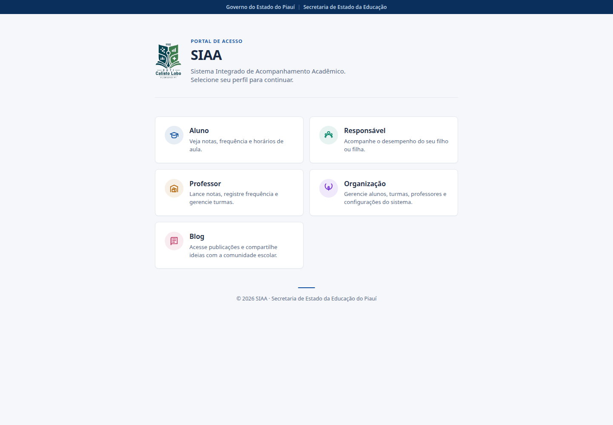
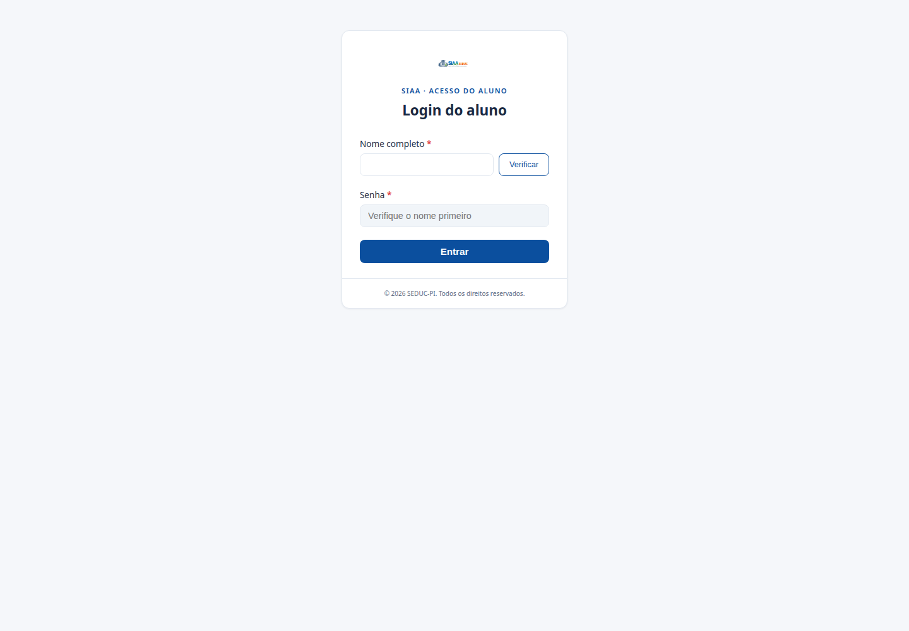

# SIAA-SEDUC: tecnologia feita na escola para aproximar a comunidade escolar

**Um retrato do desenvolvimento de uma plataforma de acompanhamento acadêmico criada por estudantes do Ceti Calisto Lobo, em Floriano, Piauí**

**Autor:** José Cipriano — estudante do Ceti Calisto Lobo e integrante do desenvolvimento do projeto

**Data:** 22 de outubro de 2026
**Palavras-chave:** educação pública; tecnologia educacional; gestão escolar; desenvolvimento de software; Piauí.

## Resumo

O SIAA-SEDUC — Sistema Integrado de Acompanhamento Acadêmico — é uma plataforma web em desenvolvimento para reunir, em um só lugar, informações e rotinas importantes da vida escolar. A iniciativa nasceu do trabalho de alunos do Ceti Calisto Lobo, em Floriano, no Piauí, e busca tornar mais próximo o diálogo entre estudantes, responsáveis, professores e equipes de organização escolar. Este artigo apresenta o propósito do sistema, sua arquitetura, os módulos disponíveis e o estágio atual do projeto, a partir da documentação e do código-fonte consultados em outubro de 2026. A solução combina uma interface web construída com Next.js e React e uma API desenvolvida com Django e Django REST Framework. Entre as funcionalidades já representadas no sistema estão consultas de boletim e frequência, gestão de turmas, atividades e avaliações, comunicação escolar e ferramentas de coordenação. Mais do que descrever tecnologias, o texto apresenta uma experiência de aprendizagem: transformar necessidades observadas na comunidade escolar em software construído por estudantes.

## 1. Introdução

Uma informação escolar pode estar espalhada entre cadernos, mensagens e diferentes sistemas. Quando isso acontece, acompanhar notas, faltas, atividades e avisos exige tempo de estudantes, famílias e profissionais da escola. O SIAA-SEDUC parte de uma ideia simples: facilitar esse acompanhamento reunindo diferentes rotinas escolares em uma plataforma acessível pela web.

O projeto é desenvolvido por alunos do **Ceti Calisto Lobo**, em **Floriano, Piauí**. Essa origem é parte essencial da iniciativa: estudantes aprendem construindo uma ferramenta relacionada a desafios reais da educação e podem apresentar uma solução pensada a partir de sua própria comunidade.

O desenvolvimento está em andamento. Portanto, este artigo não trata o sistema como um produto concluído nem afirma resultados de impacto que ainda não foram medidos. Seu objetivo é descrever, de forma clara e acolhedora, a proposta e a estrutura que o projeto apresenta até o momento.

## 2. Objetivo e abordagem

O objetivo central do SIAA-SEDUC é apoiar o acompanhamento acadêmico e a organização de informações escolares. Para isso, a aplicação oferece áreas específicas para diferentes perfis, como estudante, responsável, professor e equipe de organização.

Este texto é um **relato descritivo do projeto**. A visão apresentada foi elaborada a partir da leitura do repositório público, da documentação do sistema e da observação das páginas disponíveis na aplicação publicada. As imagens abaixo registram telas públicas e não exibem dados escolares de usuários. Não foi realizada uma avaliação formal de usabilidade, segurança, desempenho ou impacto educacional; essas análises podem fazer parte de etapas futuras.

## 3. Como o projeto é estruturado

O SIAA-SEDUC segue uma arquitetura web dividida em duas partes principais:

```text
Pessoa usuária
      │
      ▼
Frontend — Next.js e React
  • páginas e navegação por perfil
  • formulários e apresentação das informações
      │
      ▼
API — Django e Django REST Framework
  • regras do sistema e operações escolares
  • comunicação entre a interface e os dados
      │
      ▼
Persistência de dados
  • SQLite no desenvolvimento
  • PostgreSQL previsto para produção
```

O **frontend** está na pasta `frontend/`. Ele utiliza Next.js com App Router e React, organizando as páginas em rotas como `/aluno`, `/professor`, `/responsavel`, `/coordenacao` e `/blog`. Os estilos são organizados principalmente com CSS Modules.

O **backend** está na pasta `django_siaa/`. Nele, Django e Django REST Framework dão suporte à API e às regras do domínio escolar. A aplicação principal encontra-se em `django_siaa/app/`, com modelos, operações da API, migrações e testes.

O modelo de dados contempla entidades como estudantes, professores, disciplinas, turmas, notas, frequência, aulas, conteúdos, atividades, avaliações, comunicados, eventos e mensagens. As relações entre esses registros permitem, por exemplo, associar notas e frequência a estudantes, disciplinas, turmas e professores. No caso das notas, o sistema guarda informações por trimestre e mantém campos para médias e resultados finais, evitando tratar o boletim como um único número isolado.

## 4. O que a plataforma oferece

As funcionalidades estão organizadas para que cada público encontre o que é mais relevante para sua rotina:

| Área | Exemplos de recursos |
|---|---|
| **Estudante** | Consulta de boletim, frequência, horários, conteúdos, atividades e solicitações. |
| **Responsável** | Acompanhamento de informações do estudante, comunicados, calendário e canais de mensagem. |
| **Professor** | Acesso a turmas, lançamento de notas, registro de frequência, publicação de conteúdos, atividades, avaliações e comunicados. |
| **Coordenação e organização** | Gestão de estudantes e professores, turmas, horários, calendário, comunicados, avaliações e advertências. |
| **Blog** | Espaço para publicações e compartilhamento de ideias com a comunidade escolar. |

Essa divisão ajuda a tornar a navegação mais intuitiva: em vez de apresentar as mesmas ferramentas para todo mundo, o portal começa pelo perfil de quem vai utilizá-lo.

### Uma primeira visão do portal



*Figura 1 — Portal público do SIAA-SEDUC. Captura da aplicação publicada em outubro de 2026.*

### Acesso do estudante



*Figura 2 — Tela de acesso do estudante. A imagem mostra o formulário vazio, sem dados de usuário.*

## 5. Tecnologias e decisões de implementação

No frontend, o uso de **Next.js** organiza a aplicação em páginas e rotas, enquanto o **React** compõe as interfaces. O repositório registra Next.js 16 e React 19. A separação por perfis e módulos torna mais simples localizar as páginas responsáveis por cada área do sistema.

No backend, **Python, Django e Django REST Framework** sustentam a API e a lógica da aplicação. Essa camada centraliza operações que não devem depender apenas do navegador, como registrar dados acadêmicos e relacionar cada informação à turma correspondente.

As notas escolares merecem cuidado especial. O modelo utiliza campos decimais para armazenar avaliações e médias, além de registrar notas por trimestre. Também contém lógica para calcular médias trimestrais e anuais e considerar a recuperação conforme as regras implementadas no projeto. Usar representação decimal é uma escolha importante para evitar imprecisões desnecessárias em valores acadêmicos.

Para persistência, a documentação do projeto descreve SQLite no desenvolvimento local e PostgreSQL como opção para produção. Essa organização permite que o ambiente de trabalho dos estudantes seja mais simples, mantendo a possibilidade de utilizar um banco de dados voltado a uma implantação mais ampla.

## 6. Um projeto de aprendizagem e colaboração

O SIAA-SEDUC é, ao mesmo tempo, uma iniciativa de software e um processo de formação. Ao trabalhar em uma aplicação com diferentes perfis, dados relacionados e funcionalidades reais, os estudantes exercitam programação, organização de código, modelagem de informações, documentação e colaboração.

Entre os alunos que contribuem para o projeto, **José Cipriano é o estudante com mais contribuições**, conforme informado para este artigo. Esse reconhecimento é também um convite para acompanhar o histórico público do repositório, onde o trabalho coletivo pode ser visto ao longo do tempo.

O projeto também é apresentado no repositório como uma iniciativa relacionada à **FAPEPI / SEDUC-PI**. Sua evolução depende da continuidade do desenvolvimento, da validação com a comunidade escolar e do cuidado com os dados e as necessidades de cada público.

## 7. Estágio atual, limites e próximos passos

Em outubro de 2026, há uma aplicação publicada e um conjunto amplo de módulos representados no código e na documentação. O portal apresenta os caminhos de acesso aos principais perfis, e o repositório contém páginas e modelos para diferentes rotinas escolares. Isso demonstra uma base funcional em evolução, não uma declaração de que todos os fluxos estejam finalizados ou que já tenham sido avaliados em escala.

Como próximos passos naturais, o projeto pode priorizar:

- validar as telas e os fluxos com estudantes, responsáveis, professores e coordenação;
- ampliar os testes automatizados para regras de notas, frequência e permissões;
- aprimorar continuamente acessibilidade, clareza da navegação e uso em dispositivos móveis;
- documentar as funcionalidades e acompanhar correções e melhorias com transparência;
- avaliar, com critérios definidos, a experiência de uso e os benefícios para a rotina escolar.

Esses pontos são possibilidades para a continuidade do trabalho, não funcionalidades ou resultados que este artigo afirme já estarem concluídos.

## 8. Considerações finais

O SIAA-SEDUC mostra como uma ideia nascida no ambiente escolar pode se transformar em uma experiência concreta de desenvolvimento. Ao aproximar estudantes, famílias, professores e equipe escolar em torno de informações acadêmicas, o projeto busca tornar a comunicação e o acompanhamento mais organizados.

Seu valor também está no caminho percorrido: estudantes do Ceti Calisto Lobo aprendem tecnologia construindo uma solução ligada à realidade de Floriano e da educação pública. O sistema continua em desenvolvimento, e é justamente essa construção aberta — feita de aprendizado, colaboração e melhorias sucessivas — que torna a iniciativa interessante de acompanhar.

## Links do projeto

- **Aplicação:** [siaa-frontend.vercel.app](https://siaa-frontend.vercel.app)
- **Código-fonte e histórico de contribuições:** [github.com/Sh4luK/siaa-seduc](https://github.com/Sh4luK/siaa-seduc/)
- **Documentação técnica do repositório:** [DOCUMENTATION.md](DOCUMENTATION.md)

## Referências

1. SIAA-SEDUC. **Repositório do projeto e código-fonte**. Disponível em: [https://github.com/Sh4luK/siaa-seduc/](https://github.com/Sh4luK/siaa-seduc/). Acesso em: 22 out. 2026.
2. SIAA-SEDUC. **Aplicação web**. Disponível em: [https://siaa-frontend.vercel.app](https://siaa-frontend.vercel.app). Acesso em: 22 out. 2026.
3. SIAA-SEDUC. **Documentação do projeto**. Arquivo `DOCUMENTATION.md` no repositório.
